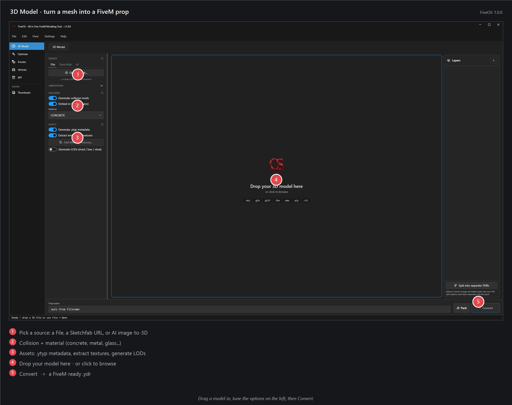

# 3D Model — turn a 3D file into a FiveM prop

Have a 3D model (`.glb`, `.fbx`, `.obj`, and more)? Drop it here and FiveOS turns it into a prop you can place in your server.

## How to use it
1. Drag your model onto the preview area.
2. Move, rotate, or scale it with the handles. Press **W** to move, **E** to rotate, **R** to scale.
3. Check the size numbers. If they turn red, your model is too heavy — see the Optimize tab to shrink it.
4. Type a name at the bottom (or leave it to fill in from the file name).
5. Click **Convert**.

Your finished files go to your Documents folder, under **FiveOS\Output**. Drop them into your server's `resources`.

## Tips
- A person-shaped figure stands next to your model so you can check it's the right size.
- Use the **Match** button to snap your prop to a normal height.
- Toggle **Wireframe** at the bottom-right to see the shape without colors.

## Import a model from GTA V's own files

Want to start from something that's already in the game — a bench, a TV, a vending machine — and retexture or rename it? In the **SOURCE** panel pick the **Game** tab.

1. The first time, FiveOS indexes your GTA V install (a few seconds; it needs the folder with `GTA5.exe`, the same one the Vehicles and Emotes tabs use).
2. Type part of a model name — `prop_bench`, `fridge`, `chair`. Every word must match; `prop_*` names list first. Results show the file kind: `.ydr` (plain drawable), `.yft` (fragment — vending machines, fridges, anything that breaks or has physics), `.ydd` (a dictionary of several models). Add `yft` or `ydd` to the search to narrow by kind.
3. Double-click a result (or press **Enter** on the top match). FiveOS copies the model **and the texture dictionaries it uses** out of the game files and loads it like any other file — textured preview, handles, layers, everything.

Textures are found the way the game finds them: the model's own `.ytd`, its `+hi` / `+hifr` high-detail set (preferred when it's larger than the embedded copy), the texture dictionary its archetype names, that dictionary's `gtxd` parents, and finally the other dictionaries in the same folder. A `.ydd` loads every model it contains as its own mesh group — use the layers panel to separate the one you want.

What you get is a normal loaded model, so every option below applies. Two things to know:

- **Name:** the name box fills in with the game's model name. Keep it and your export **replaces** that prop server-wide (handy for a retexture); change it to ship a new prop alongside the original.
- The prop is rebuilt from the preview mesh, so the result is a fresh prop with embedded textures rather than a byte-for-byte copy of the game's file. A fragment's breakable pieces are left out.

If a texture still can't be found (a few props reference dictionaries the game only links through a map), the status says so and the preview is partly untextured — use **Add textures…** if you need them in the export. The game files are only read, never written.

## Move the pivot (where the prop turns and gets placed from)

By default a prop rotates and scales around its centre, and exports with the origin its file already had. That's wrong for anything hinged: a door should swing from its hinge, a sign should turn on its post.

Press **P** (or click **Pivot** on the viewport toolbar) and drag the arrows to put the pivot wherever it belongs — on the hinge, a base corner, the foot of a pole. **The model doesn't move; only the pivot does.** Switch back to Rotate (**E**) and the model now turns around that point.

Once you've moved it, the pivot is **baked into the export**: the point you chose becomes the prop's origin, so that's what the game places it by and rotates it around — in a `CreateObject` spawn, in housing menus, and in animations.

Click **Pivot** again (or **Reset pivot to centre** in the TRANSFORM panel) to put it back; the export then keeps the file's own origin, exactly as before.

## Undo

**Ctrl+Z** / **Ctrl+Y** work from anywhere in the workspace, including while the mouse is over the 3D view — handy right after a gizmo drag. They cover the sidebar settings, the transform, and the pivot. Typing a name is one undo step, not one per letter.

## Textures (how the game gets them)

FiveOS props ship **textures embedded inside the `.ydr`** (the drawable’s own texture dictionary). The matching `.ytyp` leaves `textureDictionary` empty, so the game does **not** look for a separate `.ytd` in `stream/`. That matches how most custom props and housing furniture packs work — one file, spawn with `CreateObject` / housing menus, no extra TXD name to wire up.

On Convert (and on **Build recolor pack**), FiveOS:

1. Pulls every usable diffuse / base-color and normal map from the model (embedded in the file, or sitting next to it in a `textures/` folder).
2. Bakes them into the `.ydr` as DDS.
3. Points the shader samplers at those embedded maps only (no dangling names).

Leave **Extract embedded textures** on unless you are deliberately shipping your own `.ytd` and know how to set the archetype’s texture dictionary name.

**Recolor pack:** each library image becomes its own prop with that image embedded as the diffuse; normals from the base convert stay embedded so the variant still looks right in-game.

## If it doesn't work
- **Model is tiny or huge:** it was saved in the wrong units — re-export it from your 3D program in metres.
- **No texture showing:** use **Add textures…** in the TEXTURES panel (or the layer’s Change textures menu) and pick the picture files — they show in the preview and bake into the export on Convert. Textures next to the model (or in a `textures/` folder beside it) are also picked up automatically.
- **Pink / missing in-game but fine in preview:** the export needed embedded maps — turn **Extract embedded textures** on and Convert again (or rebuild the recolor pack).
- **Convert button greyed out:** you haven't loaded a model yet — drag one in first.
