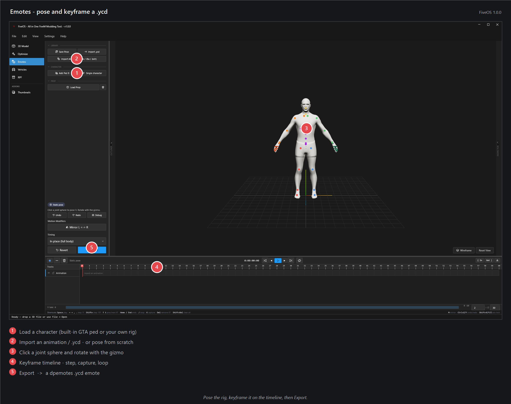
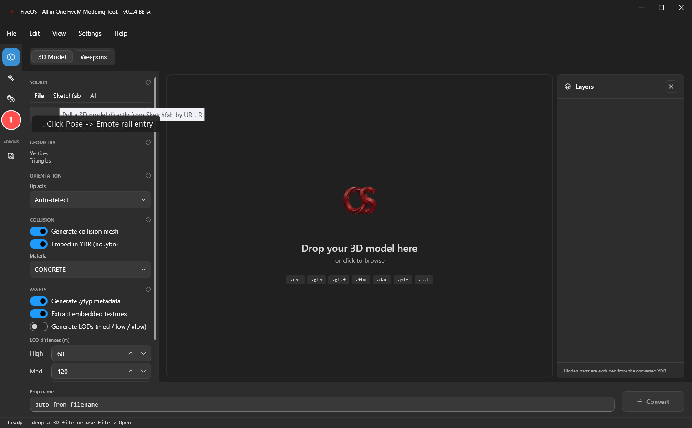
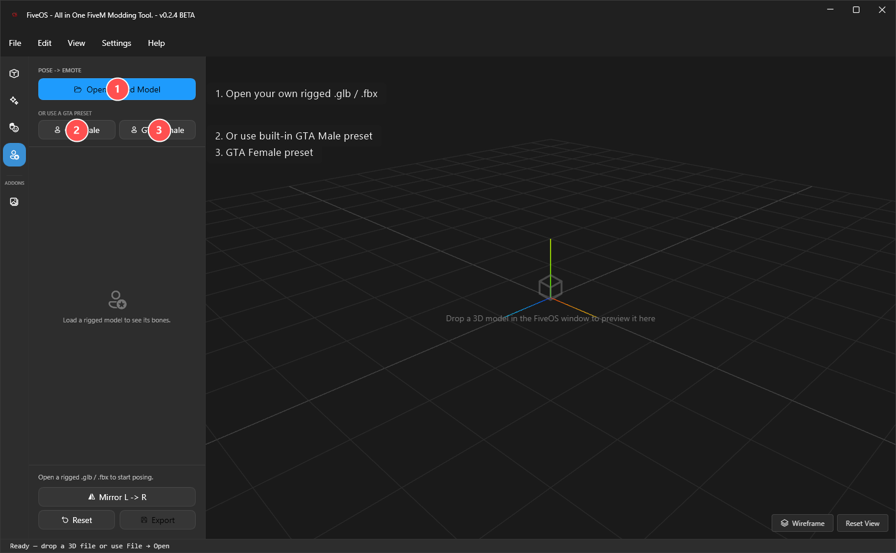
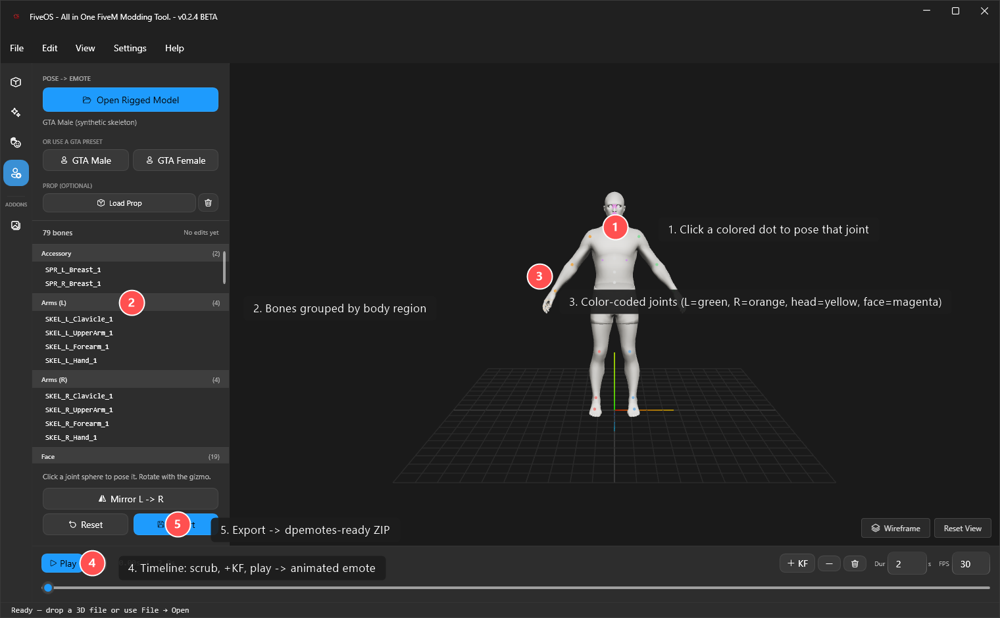

# Pose → Emote — make a FiveM emote from scratch

Pose a character, hit Export, and you get a ready-to-use FiveM emote. No 3D experience needed — about 5 minutes.

You'll need FiveOS and a FiveM server with **dpemotes** (most servers already have it). You don't need GTA V installed — FiveOS comes with its own character to pose.

## Steps

1. Open FiveOS and click **Emotes** on the left. Stay on **Pose → Emote**.

   

2. Click **GTA Male** to load the built-in character (the easy path).

   

3. A figure appears with colored dots on every joint. Click a dot to grab that joint.

   

4. Drag the colored rings that pop up to rotate the joint. Repeat until the pose looks right. **Mirror L→R** copies a left-arm pose to the right. **Reset** undoes everything.

5. Click **Export**, pick a short lowercase name like `mywave`, and save. That name is what players type in-game: `/e mywave`.

6. Install it — see **[EXPORT_TO_FIVEM.md](EXPORT_TO_FIVEM.md)**.

## Want it to move?

The timeline has two editing modes:

- **Sequencer** edits whole animation clips. Click to select, drag to move, drag either edge to trim, or use Split at the playhead. Shift/Ctrl select multiple clips; drag empty space for marquee selection.
- **Dope Sheet** edits keys on individual bones. Search the track hierarchy, select or box-select keys, drag to retime, set easing with the right-click menu, and mute or lock tracks.

Pose the character and click the key button to capture a key at the playhead. Use **Space** to play, **Delete** to remove the selection, **Ctrl+C/V/D** to copy, paste, or duplicate, and **Ctrl+Z/Y** to undo or redo. Mouse-wheel pans; Ctrl+wheel zooms; **Snap** keeps edits on frame boundaries (hold Shift to bypass it).

Animation imports remain visible while processing: the editor stays usable and reports progress in a small non-blocking HUD.

## Put a prop in their hand

A phone, a bottle, a mic, a clipboard — click **Prop** in the toolbar and one appears in the ped's hand, already gripped. It opens with a demo phone so there's something to look at straight away.

1. **GTA prop model** is what the emote actually spawns in game. The list is common base-game hand props, but any model your server streams works — type its name.
2. **Attach to** picks the bone it hangs off. Hands use the game's `PH_` prop-handle bones, so a zero offset is already a natural grip.
3. Play the animation back — the prop rides the bone, so it follows the hand instead of floating where you left it.
4. **Mesh…** loads your own `.glb` / `.fbx` / `.obj` as the preview shape, for when the prop is custom and you want to see the real thing while you pose. The in-game prop is still the model name above.

Click the prop to grab it and the **TRANSFORM** bar switches over to it. The Prop flyout carries **Move** / **Rotate** / **Size** buttons that do the same thing, so the gizmo isn't something you have to already know about.

- **Move** (**W**) and **Rotate** (**E**) author the prop's *grip* — an offset and a rotation against its bone. That pair is exactly what the emote stores, and you can type it as well as drag it: the **Placement** fields are the six floats the export writes, in metres and degrees, live against the gizmo in both directions.
- **Size** (**R**) resizes the *preview only*. A prop's real size is a property of its model: `PropPlacement` is six floats and nothing else, and the game has no entity-scale native, so there is nowhere for a size to ship. It still matters that you get it right — a grip authored against a mesh twice the size it will be in-game is itself wrong.
- **Preview mesh** holds the other correction that never ships: **Orient**, for an import that landed at an angle. Straighten the mesh *there*, not with Rotate — rotating the grip would send your correction out to the game and point the prop the wrong way in someone's hand. **Y-up** is the one-click preset for a Blender / glTF export (+90° about X), and the reset button puts the mesh back without touching the grip.
- Pivot, Match and Ground disappear while the prop has the bar — they measure the ped, not the object in its hand.
- **Reset** re-snaps the prop to its bone's origin, back to the natural grip. It touches neither the ped nor the preview size.
- Picking the prop clears any bone or IK selection, so **W** / **E** / **R** drive the prop and not the body.

On export the prop goes out with the emote as its model, bone and placement — works for rpemotes, dpemotes and standalone packs.

## Build an emote pack

Making more than one emote? Instead of exporting each as its own resource, queue them into a **pack** — one folder, one `ensure` line, every emote inside.

1. Pose (or import) an emote as usual, then open the **Pack** tab on the right edge and click **Add to Pack**.
2. Give it a name — that's what players type, e.g. `wave` → `/wave` — and a menu label.
3. Repeat for the next emote. Open a new tab, load whatever character you like, and add that one too.
4. In the same panel: rename commands, reorder with the arrows, switch one off with the eye if you don't want it shipped, and name the resource at the top.
5. Click **Export Pack** and pick where to put it. You get a ready-to-go folder: `fxmanifest.lua`, `client.lua`, one animation file per emote under `stream/`, and a README.
6. Copy the folder into your server's `resources/`, add `ensure <pack name>` to `server.cfg`, and restart.

In game, `/<pack name>` lists everything in the pack, each emote answers to its own command, and `/<pack name> stop` cancels. The README that ships in the folder covers the rest.

Two things worth knowing:

- **Adding bakes immediately.** What's on screen when you click Add to Pack is what gets packed — carry on editing afterwards and the queued copy won't change. To update one, remove the row and add it again.
- **The queue is for one sitting.** It lives in memory, so closing FiveOS empties it. Export before you quit.

## Synced emotes — two players or a whole group

Handshakes, hugs, carrying someone, a five-person group pose. Click **Sync Pair** in the toolbar and a teal ghost appears next to your ped. Every ghost is another player, and where it stands is exactly where that player gets placed in game.

1. Drag **Front**, **Side** and **Height** to position the partner, and **Heading** to turn them — **180°** means the two players face each other. A handshake sits around **0.9–1.2 m** front.
2. **+ Add** puts another player in the formation, up to five partners. **Remove** takes the selected one out.
3. Keep using the viewport while the window is open — orbit the camera, press **Space** to play, scrub the timeline. Everyone animates together, so you can see the whole formation move before you commit to it.
4. Give it an **emote name** and a **menu label**, then pick where it goes.

Partner bodies match whatever ped is in your preview automatically. That is preview only — any ped can accept in game.

### Where it installs

- **RPEmotes** drops it straight into your `rpemotes-reborn` resource. Two players only — that is a limit of the shared format, not of FiveOS.
- **Standalone FiveM resource** is self-contained: its own command, its own accept prompt, its own sync logic, no rpemotes needed. **Any formation with more than one partner has to use this option.**

### How the standalone one behaves in game

The initiator runs `/<name>` near the others. Everyone else gets a chat prompt and answers `/<name> accept`. Nothing happens until **every** slot is filled — then the server fires one start event, each accepted player is teleported to the offset you authored, and the whole formation plays at the same instant. That wait is the point: it is what stops a two-person emote playing half-finished because someone was slow.

## Import an animation

Already have motion — from Mixamo, ActorCore, Cascadeur, the CMU BVH library, or a Sims 4 pose pack? Click **Import Animation** and pick the file (`.glb` / `.gltf` / `.fbx` / `.dae` / `.bvh` / `.package`). FiveOS retargets it onto the GTA skeleton and drops it on the timeline as keyframes; tweak it there and Export like any other emote. **Import .ycd** does the same for an existing GTA animation you want to edit.

### Best results: export in the retarget's sweet spot

The retarget is tuned for one clean input: a **humanoid rig in a T-pose bind** (arms out horizontal), Y-up, with the animation baked. FiveOS now runs an **input health check** on every import and tells you — right in the status bar — whether your file is in that sweet spot (`✓ T-pose bind detected`) or needs a better export (`⚠ A-pose … re-export in T-pose`). Aim for the `✓`. Per source:

| Source | Export it like this |
| --- | --- |
| **Namespaced mocap FBX** | Export the **pre-retarget FBX** (Mixamo-compatible bone names) and include the **frame `-1` T-pose** as the bind. |
| **Mixamo** | Download **FBX**, "With Skin", default **T-pose** — do not pick an A-pose character. |
| **Rokoko** | Retarget to a **Mixamo/HumanIK** target and export FBX in T-pose. |
| **ActorCore / Character Creator** | Export FBX with the **CC_Base** rig in T-pose (not the A-pose "Calibration" pose). |
| **Cascadeur** | Bake the animation, ensure the rest/bind frame is a **T-pose**, export FBX. |
| **Blender** | Pose the armature to a **T** before export; glTF or FBX both work. |

An A-pose or "relaxed" bind still imports, but the arms and shoulders will sit less faithfully — the health check will flag it so you know before you dig into the viewport.

If a pose reads slightly wrong on the ped — arms clipping the body, a stance that's too closed — open the **Inspector** rail (right edge) and adjust **Body Calibration** while the preview updates live.

## Tips
- The dots are color-coded by body part (green = left arm, orange = right arm, and so on).
- Hotkeys: **W** move, **E** rotate, **R** scale. **F** frames the selected bone, **K** sets a keyframe, **M** mirrors the pose.
- Saved poses live in the sidebar — pose the ped, hit **Save Pose**, and re-apply it any time with one click.
